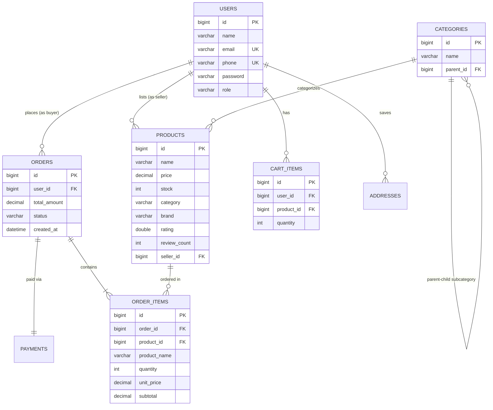

# SS Supermarket — Complete Technical & Module Documentation

**Project Name:** SS Supermarket  
**Architecture:** Enterprise Full-Stack E-Commerce Application  
**Runtime:** Java 17 | Spring Boot 3.3.5 | Hibernate ORM | Thymeleaf | HTML5/CSS3/JavaScript  
**Persistence:** MySQL 8.0 (Local Development) & PostgreSQL 16 (Render Cloud Production)  
**Deployment Platform:** Render (Docker Web Service `srv-db4i9bui0phs73cp652g`)  
**Live Application URL:** [https://ss-supermarket.onrender.com](https://ss-supermarket.onrender.com)

---

## Table of Contents
1. [System Architecture Overview](#1-system-architecture-overview)
2. [Module 1: Authentication & Security Module](#2-module-1-authentication--security-module)
3. [Module 2: Database & Data Persistence Module](#3-module-2-database--data-persistence-module)
4. [Module 3: Product Catalog & Categories Module](#4-module-3-product-catalog--categories-module)
5. [Module 4: Shopping Cart Module](#5-module-4-shopping-cart-module)
6. [Module 5: Checkout, Payment & Order Processing Module](#6-module-5-checkout-payment--order-processing-module)
7. [Module 6: Seller Portal & Multi-Vendor Inventory Module](#7-module-6-seller-portal--multi-vendor-inventory-module)
8. [Module 7: Admin Administration Module](#8-module-7-admin-administration-module)
9. [Module 8: AI Shopping Assistant & Chatbot Module](#9-module-8-ai-shopping-assistant--chatbot-module)
10. [Module 9: UI/UX & Dark/Light Theme Module](#10-module-9-uiux--darklight-theme-module)
11. [Module 10: Deployment & DevOps Module](#11-module-10-deployment--devops-module)

---

## 1. System Architecture Overview

The system is constructed following the **Spring MVC 3-tier Layered Architecture**:

```mermaid
flowchart TD
    Client["Client Browser (Desktop / Mobile)"]
    
    subgraph Presentation Layer
        Thymeleaf["Thymeleaf HTML5 Templates"]
        StaticAssets["CSS Variables + Vanilla JS + Assets"]
    end
    
    subgraph Web & Security Layer
        Sec["Spring Security Filter Chain (SecurityConfig)"]
        Controllers["Controllers (MVC View Controllers + REST API Endpoints)"]
        GlobalAdvice["GlobalModelAdvice (Session, Cart Count, User)"]
    end
    
    subgraph Business Service Layer
        AuthSvc["AuthService & OtpService"]
        ProdSvc["ProductService & CategoryService"]
        CartSvc["CartService"]
        OrderSvc["OrderService (@Transactional)"]
        AiSvc["AiChatService"]
    end
    
    subgraph Persistence Layer
        Repos["Spring Data JPA Repositories"]
        DBConfig["DatabaseConfig (Dynamic Multi-DB Resolver)"]
    end
    
    subgraph Database Engines
        MySQL[("Local MySQL (3306)")]
        PG[("Render PostgreSQL (5432)")]
        H2[("In-Memory H2 (Test Profile)")]
    end

    Client -->|HTTP / HTTPS Requests| Sec
    Sec --> Controllers
    Controllers --> GlobalAdvice
    Controllers --> Business Service Layer
    Business Service Layer --> Repos
    Repos --> DBConfig
    DBConfig --> MySQL
    DBConfig --> PG
    DBConfig --> H2
    Controllers --> Presentation Layer
    Presentation Layer --> Client
```

---

## 2. Module 1: Authentication & Security Module

### Purpose
Provides role-based access control (RBAC), multi-channel authentication (password or OTP), session handling, and protection against common web vulnerabilities (CSRF, session fixation, XSS).

### Key Files
- `SecurityConfig.java`: Central Spring Security filter chain configuration.
- `CustomUserDetailsService.java`: Loads user principals from database by email or phone.
- `CustomUserDetails.java`: Implements Spring Security `UserDetails`.
- `CustomAuthenticationSuccessHandler.java`: Routes users post-login by role.
- `OtpService.java`: 6-digit OTP generation, validation, and rate-limiting.
- `AuthApiController.java` & `AuthController.java`: Login/registration endpoints and views.
- `login.html` & `register.html`: Clean UI with password eye-toggle button.

### User Roles & Access Matrix
| Role | Landing Page | Accessible Routes |
|---|---|---|
| **Anonymous** | `/login` / `/` | `/`, `/products`, `/login`, `/register`, `/api/ai/chat`, `/api/products` |
| **ROLE_BUYER** | `/products` | Storefront, `/cart`, `/checkout`, `/orders`, `/profile` |
| **ROLE_SELLER** | `/seller` | Storefront, `/seller/**`, `/profile` |
| **ROLE_ADMIN** | `/admin` | Storefront, `/admin/**`, full platform oversight |

### Authentication Features
1. **Password Security:** Passwords hashed using `BCryptPasswordEncoder` (strength 10).
2. **Password Visibility:** Eye-toggle button (`togglePasswordVisibility()`) switches between hidden password and plain text.
3. **Passwordless OTP Login:** Requests 6-digit one-time password via mobile/email with 60s cooldown timer.
4. **Smart Redirection:** Post-login directs buyers to `/products`, sellers to `/seller`, admins to `/admin`.

---

## 3. Module 2: Database & Data Persistence Module

### Purpose
Abstracts database operations across diverse environments (Local MySQL, Cloud PostgreSQL on Render, and in-memory H2 during unit testing).

### Entity-Relationship Diagram (ERD)



### Key Files
- `DatabaseConfig.java`: Resolves JDBC URLs for PostgreSQL (`postgresql://...`), MySQL (`jdbc:mysql:...`), and H2.
- `DataInitializer.java`: Startup seed runner that creates the default admin (`admin@sssupermarket.com`) and 40 catalog items with ratings.
- Entities: `User.java`, `Product.java`, `Category.java`, `Order.java`, `OrderItem.java`, `CartItem.java`, `Address.java`, `Payment.java`.

---

## 4. Module 3: Product Catalog & Categories Module

### Purpose
Delivers product discovery through search queries, category trees, stock indicators, and customer star ratings.

### Key Files
- `ProductController.java` & `ProductApiController.java`: Serves `/products` web view and `/api/products` JSON APIs.
- `ProductService.java`: Business operations for search, pagination, and sorting.
- `ProductRepository.java`: JPQL methods (`searchLegacy`, `searchProducts`, `findDistinctCategories`).
- `products.html` & `product-details.html`: Storefront catalog and single-item product detail pages.

### Catalog Capabilities
- **Hierarchical Categories:** Parents (e.g. *Groceries*) contain subcategories (e.g. *Fresh Fruits*, *Dairy & Bakery*).
- **Search & Filters:** Real-time search across product name, brand, description, and category.
- **Product Rating Display:** Every product card features gold star rating out of 5 (e.g., `⭐ 4.6/5.0 (32 reviews)`).
- **Stock Badging:** Real-time unit stock (`In Stock`, `Only X Left`, or `Out of Stock`).

---

## 5. Module 4: Shopping Cart Module

### Purpose
Manages real-time buyer carts backed by the database. Ensures buyers can add products from any device and keep their cart saved across sessions.

### Key Files
- `CartController.java` & `CartApiController.java`: Cart web endpoints (`/cart`, `/cart/add/{id}`, `/cart/update`, `/cart/remove/{id}`).
- `CartService.java`: Calculates quantities, subtotal, taxes (GST 5%), delivery charge (FREE over ₹499, else ₹30).
- `CartItemRepository.java`: Per-user cart queries.
- `GlobalModelAdvice.java`: Injects live `cartCount` into the navbar across all pages.
- `cart.html`: Responsive table showing item images, live price updates, and quantity incrementors.

---

## 6. Module 5: Checkout, Payment & Order Processing Module

### Purpose
Executes transactional order placement, verifies real-time stock using locks, generates order invoices, and handles multiple payment types.

### Key Files
- `OrderController.java` & `OrderApiController.java`: Routes `/checkout`, `/order-success`, and `/orders`.
- `OrderService.java`: `@Transactional` checkout business logic.
- `checkout.html`, `order-success.html`, `orders.html`.

### Checkout Workflow
1. Buyer enters shipping address and selects payment method.
2. `OrderService.checkout()` runs atomically:
   - Validates cart is non-empty.
   - Acquires pessimistic lock on inventory to verify product stock.
   - Decrements product stock count.
   - Creates `Order` and `OrderItem` snapshots (saving price at purchase time).
   - Generates initial `Payment` record (`PENDING` or `SUCCESS`).
   - Clears the buyer's cart items.
3. Redirects to `/order-success` with a printable order confirmation invoice.

### Payment Methods
- **Cash on Delivery (COD)**
- **UPI (Google Pay, PhonePe, Paytm)**
- **Credit / Debit Cards**
- **Net Banking**

---

## 7. Module 6: Seller Portal & Multi-Vendor Inventory Module

### Purpose
Empowers registered sellers to publish products, update prices, manage stock, and monitor incoming sales revenue.

### Key Files
- `SellerController.java` & `SellerApiController.java`: Dedicated routes protected by `ROLE_SELLER`.
- `seller.html`: Responsive seller dashboard with metrics, inventory table, and modal editing.

### Seller Portal Features
1. **Sales Summary Metrics:**
   - Active Listed Products Count
   - Total Orders Count
   - Total Gross Sales Revenue (`₹...`) with null safety
2. **Add Product Form:** Direct listing with immediate publication to the storefront.
3. **HTML5 Edit Product Modal:** Edit product title, brand, price, stock, image URL, and description without page reloads.
4. **Delete / Deactivate Product:** Soft removal or deletion of seller catalog items.
5. **Customer Orders Overview:** View purchase orders containing seller items with status tags.

---

## 8. Module 7: Admin Administration Module

### Purpose
Provides platform-level management for the supermarket super-administrator (`admin@sssupermarket.com`).

### Key Files
- `AdminController.java` & `AdminApiController.java`: Routes protected by `ROLE_ADMIN`.
- `admin.html`: System console view.

### Admin Capabilities
- High-level business analytics (Platform Gross Merchandise Value, Total Customer Accounts, Total Orders).
- Global Product Oversight (ability to moderate any product across all sellers).
- User Role Management (promote buyers to sellers, audit accounts).

---

## 9. Module 8: AI Shopping Assistant & Chatbot Module

### Purpose
Floating interactive AI assistant helping buyers find products, learn ingredients, compare prices, and understand supermarket delivery and payment policies.

### Key Files
- `AiChatApiController.java`: `POST /api/ai/chat` endpoint.
- `AiChatService.java`: Intent recognition and catalog database querying engine.
- `AiChatRequest.java` & `AiChatResponse.java`: DTOs.
- `layout.html` & `main.js`: Floating widget, message window, and auto-scroll logic.

### Capabilities
- **Product Lookups:** Queries database for matching products and formats specs, prices, and stock.
- **Top Rated Suggestions:** Lists items with ratings $\ge$ 4.5.
- **Budget Filtering:** Answers queries like *"show items under ₹100"*.
- **Store Policies:** Answers questions regarding 30–45 minute delivery, returns, and payment options.
- **Quick Prompt Chips:** One-click shortcuts for Top Rated, Fresh Produce, Dairy, and Delivery.

---

## 10. Module 9: UI/UX & Dark/Light Theme Module

### Purpose
Responsive, accessible, and high-contrast user interface supporting dark and light themes with zero page flickering.

### Key Files
- `layout.html`: Common layout with anti-flash script in `<head>`.
- `style.css`: CSS custom properties (`--primary`, `--bg`, `--white`, `--text`, `--border`) with `[data-theme="dark"]` overrides.
- `main.js`: `toggleTheme()` and `updateThemeIcons()`.

### Features
1. **Zero-Flash Execution:** Inline script in `<head>` checks `localStorage.getItem('ss_theme')` before rendering DOM.
2. **Persistent Preference:** Remembers user preference across sessions and pages.
3. **Full Dark Palette:** High contrast, custom table headers, card gradients, and status tags.

---

## 11. Module 10: Deployment & DevOps Module

### Purpose
Containerization and cloud deployment enabling zero-downtime hosting on Render.

### Key Files
- `Dockerfile`: Multi-stage build (Maven compile stage + Eclipse Temurin 17 JRE runtime stage).
- `.dockerignore`: Prevents local artifacts from bloating Docker build context.
- `pom.xml`: Offline and container-ready build dependencies.

### Deployment Details
- **Render Web Service:** `srv-db4i9bui0phs73cp652g` (`https://ss-supermarket.onrender.com`).
- **Render PostgreSQL Database:** `dpg-db4tucg473hc73954ai0-a` (`sssupermarket`).
- **Continuous Deployment (CD):** Pushing to `origin/master` (`https://github.com/saran251008-hub/SS-supermarket-.git`) triggers an automated build and deploy on Render.

---

## 12. Automated Test Suite

Run all tests offline:
```bash
mvn -o test
```

### Test Coverage Summary
- `AuthFlowIntegrationTest.java`: 15 integration tests covering registration, login, OTP verification, and role redirects.
- `CartServiceTest.java`: 9 unit tests covering quantity caps, tax calculations, and cart adjustments.
- `OrderServiceTest.java`: 7 integration tests covering transactional checkout and stock deduction.
- `ProductServiceTest.java`: 8 unit tests covering JPQL queries, categories, and ratings.
- `UserServiceTest.java`: 5 unit tests covering user profiles and credential updates.
- **Total:** **44 tests, 0 failures, 0 errors, 100% build success**.
